  

  

<h3 align="center"><code>/usr/bin</code></h3>

  
  
  
  
  
  
  
  

<h3 align="center"><code>/opt/sec</code></h3>

  
  
  
  
  
  
  

<h3 align="center"><code>/var/log</code></h3>

  

<h3 align="center"><code>/dev/tty</code></h3>

  

  <code>── EOF ──</code>
   
  <i>connection closed by foreign host.</i>

